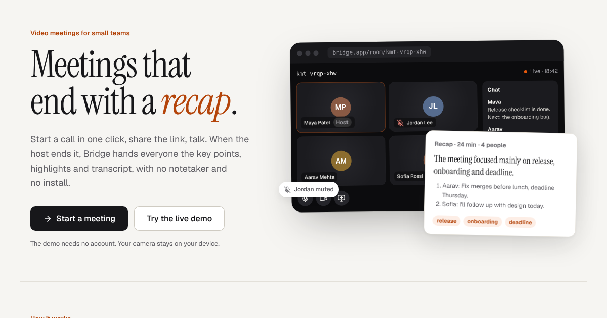
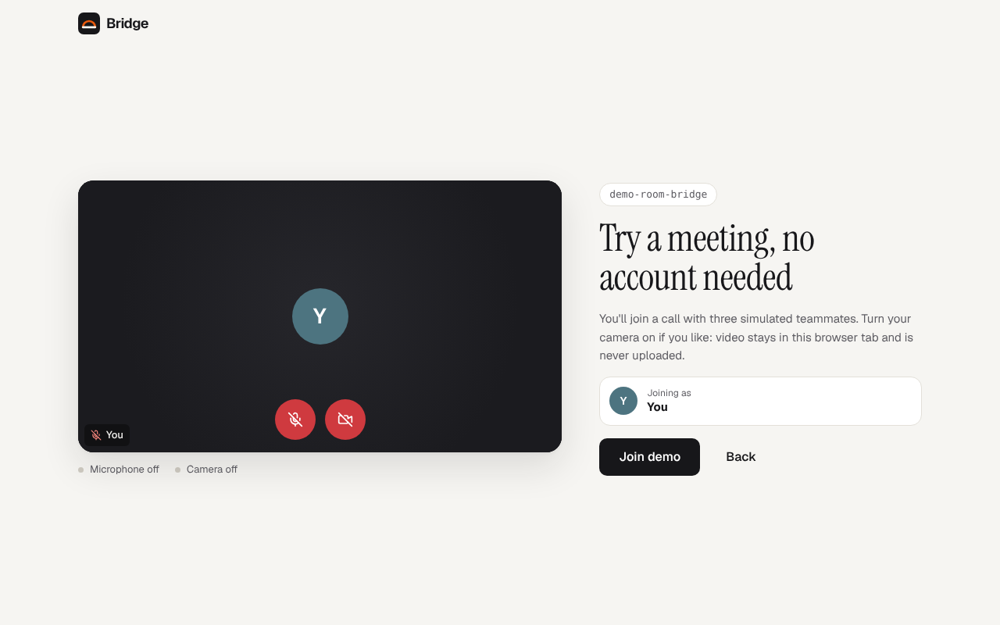
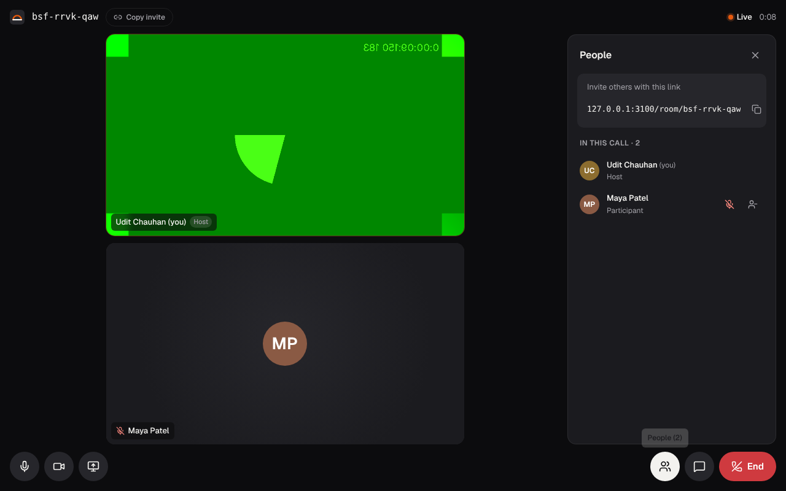
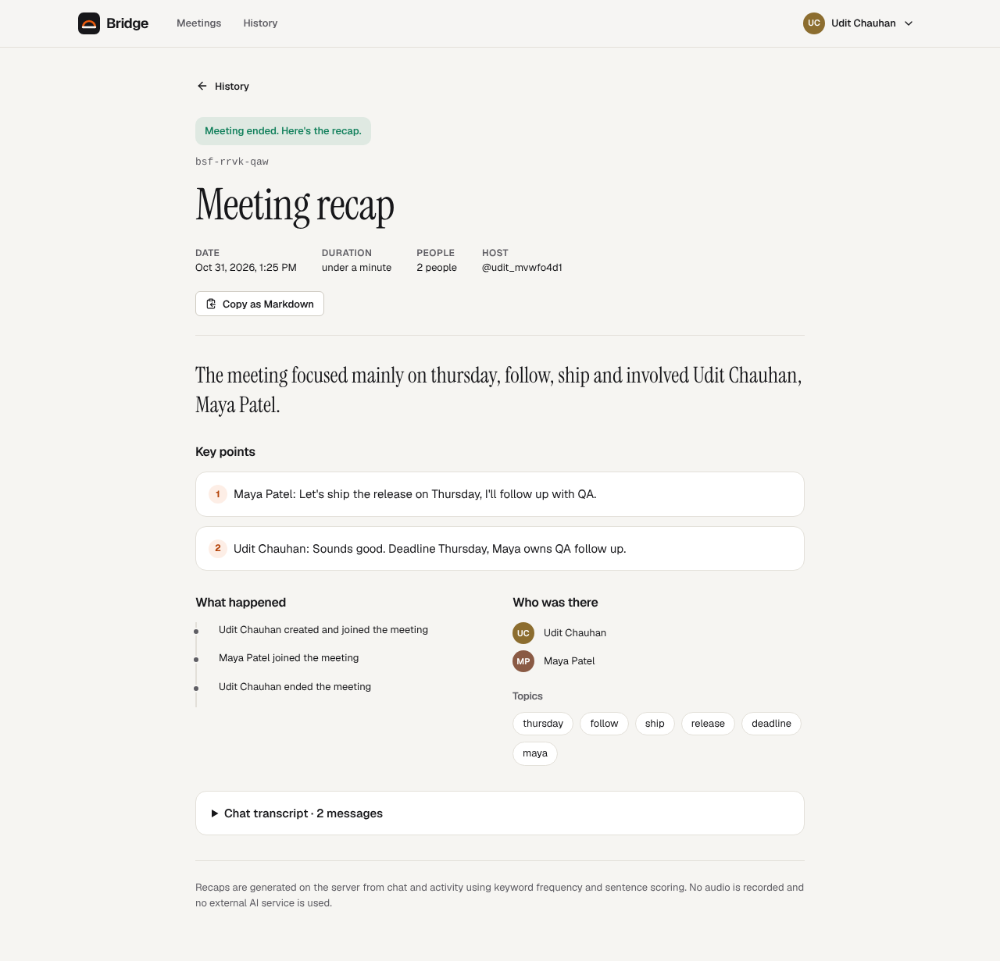

# Bridge

**Video meetings that end with a recap.** Start a call in one click, share the link, talk. When the host ends the call, Bridge gives everyone the key points, a timeline, topics and the chat transcript, with no notetaker and nothing to install.

[](https://github.com/UditSinghChauhan/videoconferencing_app/actions/workflows/ci.yml)

**[Live app](https://bridgefrontend.onrender.com)** · **[Try the demo, no sign-up](https://bridgefrontend.onrender.com/demo)** · [Architecture](ARCHITECTURE.md) · [Design system](DESIGN.md)



> [!NOTE]
> The API runs on a free hosting tier and sleeps when idle. The first request after a quiet period can take about 50 seconds; the app says so instead of failing silently.

## What it does

| | |
|---|---|
| **Start in one click** | *New meeting* creates a room with a readable code (`kmt-vrqp-xhw`). Join with a code or by pasting the invite link. |
| **Lobby** | Preview your camera, mute before joining, and get a specific fix when a device is blocked. |
| **The room** | Peer-to-peer video and audio, screen sharing with a presenter spotlight, speaking indicators, mute badges, chat and a people panel. Keyboard: <kbd>Ctrl/⌘ D</kbd> mic, <kbd>Ctrl/⌘ E</kbd> camera. |
| **Host controls** | Only the host can remove people or end the meeting, enforced by the API rather than by hiding buttons. Ending asks for confirmation. |
| **Recap** | Generated on the server from chat and activity: conclusion, key points, what happened, who was there, topics and the full transcript. Copy it as Markdown. |
| **History** | Every meeting you hosted or joined, filterable by live or ended, with duration and headcount. |
| **Resilience** | Automatic reconnect with token refresh. Opening a second tab hands the call over instead of duplicating you. Every view has loading, empty and error states. |

| Lobby | Live room | Recap |
|---|---|---|
|  |  |  |

## Architecture at a glance

```text
 Browser A  ◀──────── WebRTC media, peer to peer ────────▶  Browser B
     │                                                         │
     └──────── REST (HTTPS) + Socket.IO signalling ────────────┘
                                │
                     Node.js · Express · Socket.IO
                     JWT sessions · Zod · Winston
                                │
                             MongoDB
             users · sessions · meetings · activity · recaps
```

- **Media never touches the server.** It only authenticates, relays signalling inside a room, and keeps the record. That makes it cheap to run; the trade-off is that each person uploads one stream per participant, so rooms are designed for about six people. Larger rooms would need an SFU (see [Architecture § Scaling](ARCHITECTURE.md#9-scaling-and-what-id-do-next)).
- **WebRTC uses "perfect negotiation" with fixed transceivers.** Muting, turning the camera off and screen sharing are `replaceTrack` calls, so they never trigger another offer/answer round.
- **Sessions:** a 15-minute access token, plus a rotating refresh token in an `httpOnly` cookie bound to a server-side session, with CSRF protection and sign-out from every device.

Read [ARCHITECTURE.md](ARCHITECTURE.md) for the flows, data model, security model and design decisions.

## Tech stack

| Layer | Choices |
|---|---|
| Web | React 18, TypeScript (strict), Vite, React Router, CSS Modules with design tokens, lucide icons |
| Realtime | WebRTC (mesh, perfect negotiation), Socket.IO |
| API | Node.js, Express, Mongoose, Zod, Helmet, express-rate-limit, Winston |
| Data | MongoDB |
| Quality | Vitest, `node:test` with Socket.IO integration tests on mongodb-memory-server, Playwright with real WebRTC between two browsers, axe WCAG 2.1 AA audits, GitHub Actions |

## Run it locally

Prerequisites: Node.js 18.18+ and a MongoDB connection string (local `mongod`, Docker or Atlas).

```bash
cd backend
cp .env.example .env    # set MONGODB_URI, JWT_SECRET and JWT_REFRESH_SECRET
npm install
npm run dev             # http://localhost:8000
```

```bash
cd frontend
cp .env.example .env    # VITE_BACKEND_URL=http://localhost:8000
npm install
npm run dev             # http://localhost:3000
```

Open two browser windows (or one normal, one private) with different accounts to try a real call.

### Configuration

| Variable | Where | Purpose |
|---|---|---|
| `MONGODB_URI` | API | Database connection (required) |
| `JWT_SECRET`, `JWT_REFRESH_SECRET` | API | Token signing secrets (required, use different values) |
| `CORS_ORIGIN` | API | Comma-separated allowed origins in production |
| `COOKIE_SAME_SITE` | API | Refresh-cookie policy. Defaults to `none` (with `Secure`) in production because the web app and API are on different sites |
| `AUTH_RATE_LIMIT_MAX` | API | Sign-in attempts per IP per 15 minutes (default 10) |
| `VITE_BACKEND_URL` | Web | API base URL (`REACT_APP_BACKEND_URL` is also accepted) |
| `VITE_ICE_SERVERS` | Web | Optional JSON array of `RTCIceServer`, for example to add a TURN server for strict networks |

## Tests

```bash
cd backend && npm test          # unit + Socket.IO integration (in-memory MongoDB)
cd frontend && npm run typecheck && npm run lint && npm test && npm run build
cd frontend && npm run test:e2e # Playwright: starts the API on :8100 and the web app on :3100
```

The end-to-end suite runs Chromium with synthetic camera and microphone devices, so two browsers exchange real media. It covers:

- creating a meeting, joining by link, and two-way chat
- mute visibility, leaving and rejoining
- host removal, and ending the meeting into its recap
- recap access control, unknown codes, protected-route redirects and the public demo

It also runs an axe accessibility audit on every public page and on the room. It needs a MongoDB at `MONGODB_URI`; point it at a scratch database.

CI runs all three layers on every pull request.

## Project structure

```text
backend/
  src/
    controllers/     HTTP handlers and the Socket.IO server
    services/        auth and meeting business rules
    models/          Mongoose schemas
    middlewares/     auth, validation, rate limits, errors
    validators/      Zod schemas
    utils/           tokens, CORS, meeting codes, recap generation
    createApp.js     app wiring shared by the entry point and tests
  tests/             unit tests and integration/ (real sockets + MongoDB)

frontend/
  src/
    features/room/   PeerMesh (WebRTC), media + connection hooks, room UI
    features/meetings/  history list and recap export
    pages/           route components (code-split)
    components/      design-system primitives
    auth/  lib/  styles/
  tests/e2e/         Playwright flows and accessibility audits
```

## Known limits

- The peer-to-peer mesh is built for small rooms (about six people). Beyond that, upload bandwidth becomes the bottleneck.
- Without a TURN server, calls between some strict corporate or mobile networks cannot connect. `VITE_ICE_SERVERS` accepts one.
- Recaps come from chat and activity using keyword frequency and sentence scoring. There is no audio transcription and no external AI service.
- Socket state is in memory, so the API runs as a single instance. Scaling out needs the Socket.IO Redis adapter.

## Author

Designed and built by **Udit Singh Chauhan** · [GitHub](https://github.com/UditSinghChauhan) · [LinkedIn](https://www.linkedin.com/in/udit-singh-31382137a/)
