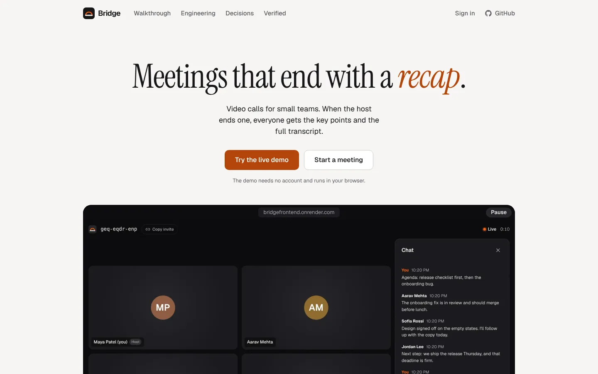
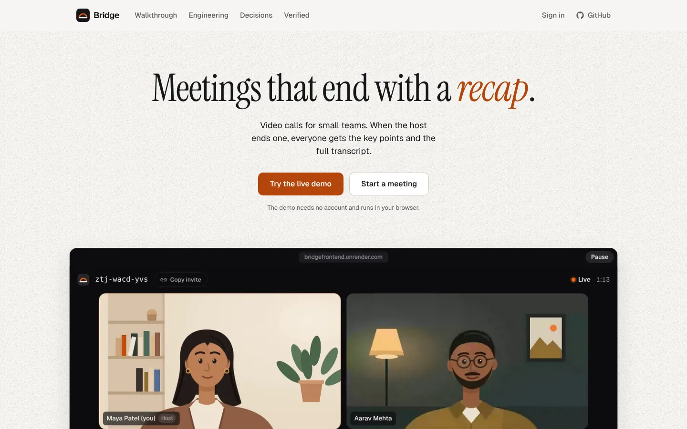
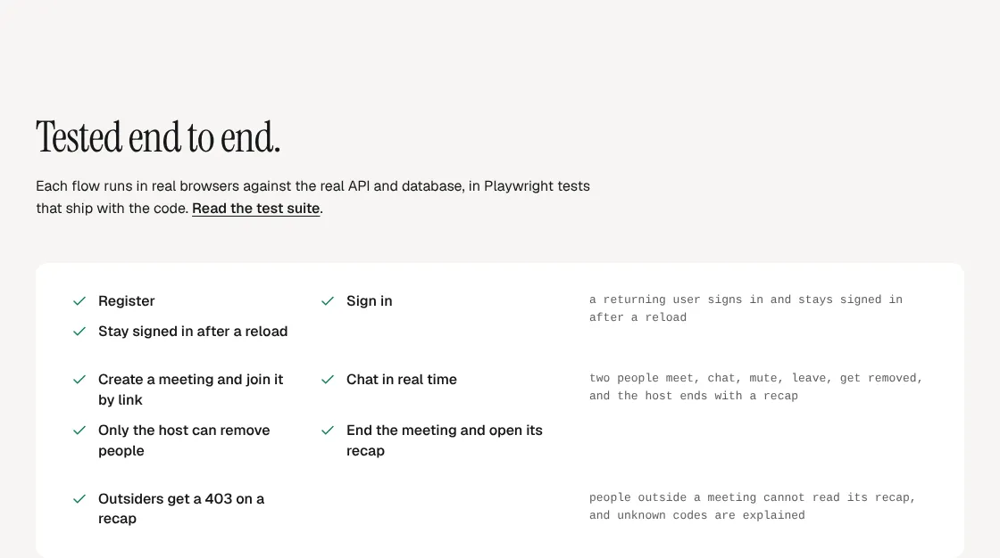
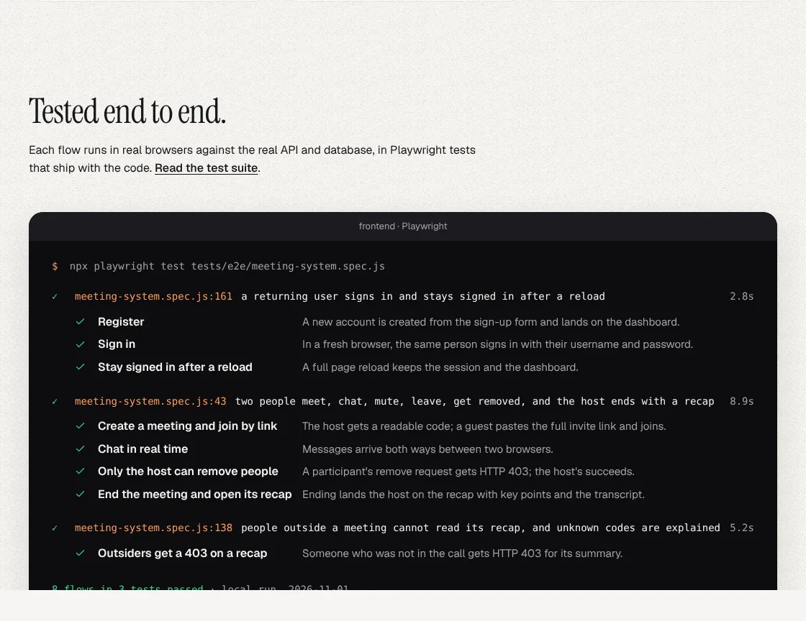

# Bridge: case study

Bridge is a video-calling app for small teams where ending a call produces a written recap: a one-sentence summary, action items with owners, key points, topics and the full transcript, for everyone who was there. Designed and built end to end by Udit Singh Chauhan.

This document holds the portfolio material that used to live on the landing page (Engineering, Decisions, Verified, the facts panel) and on the `/design-notes` route. Both were removed from the site in landing v3 (`docs/LANDING_V3.md`) because they are documentation, not product marketing. Nothing here is invented: every fact is from the repository, its history, `DESIGN.md` or `ARCHITECTURE.md`.

| | |
|---|---|
| Role | Product design, frontend and backend, solo |
| Timeline | March to November 2026: first commit on 17 March, landing revamp on 1 November, landing v3 on 3 November |
| Stack | React, TypeScript, Vite, CSS Modules, motion · Node.js, Express, Socket.IO, MongoDB · WebRTC mesh · Playwright, axe, Vitest |
| Live | https://bridgefrontend.onrender.com |

## The problem

Most calls end with nobody sure who agreed to what. The notes are in one person's head, or in a chat log that scrolls away when the tab closes. Bridge's answer is narrow on purpose: the call itself is ordinary, and the moment the host presses End the server writes the recap from the chat and activity log and saves it to every participant's history.

That one transformation is the product, so the design goal was to make it visible: a live call becoming written notes, and nothing else competing for attention.

## Two moods: workspace and room

Bridge has two surfaces with different jobs. The **workspace** (landing, sign in, dashboard, history, recap) is warm paper, ink and generous space, closer to a notebook than a dashboard. The **room** (lobby and live call) is always dark and neutral so faces and shared screens carry the colour, never the chrome. One rust accent crosses both: brand, live state, focus, and the speaking ring.

| Workspace token | Role | | Room token | Role |
|---|---|---|---|---|
| `--bg` | Page | | `--room-bg` | Room |
| `--surface` | Cards, inputs | | `--room-tile` | Tile |
| `--surface-2` | Hover, chips | | `--room-raised` | Controls |
| `--text` | Text | | `--room-text` | Room text |
| `--text-muted` | Secondary text | | `--room-muted` | Room secondary |
| `--accent` | Brand, live, focus | | `--room-danger` | End, mic off |
| `--accent-text` | Rust as text | | | |
| `--cta` | The one accent action | | | |

Contrast for every text pair is measured by `frontend/scripts/contrast.mjs`.

## The room tile

- **16:9 with a 14 px radius**, so a grid of two to six reads as one surface rather than a wall of cards.
- **Name chip bottom left**, on a translucent dark plate, because faces sit high in a webcam frame.
- **A rust ring while speaking**, driven by a real audio analyser sampled about eight times a second with a short hold, so it does not flicker between words.
- **Mic off is a red icon in the chip**, and the control itself turns red, so state never depends on colour alone.
- **Initials when the camera is off**, in a hue hashed from the name, so a person keeps the same colour everywhere; screen shares switch to `contain` so nothing is cropped.

## The recap's information design

A recap is read once, quickly, often by someone who left early. Since v3 it is ordered by what that reader needs first:

1. A status line confirming the meeting ended.
2. The title and facts: date, duration, people, host (by display name, never the internal handle).
3. One sentence on what was agreed, e.g. "Agreed to ship the release on Thursday; the onboarding fix is in review and should merge before lunch."
4. Action items: a checklist with the owner as an avatar chip and a due date.
5. Up to three key points, as statements with the speaker as an avatar chip.
6. Topics.
7. The full transcript, folded away until needed.

The recap is deterministic and has no external AI (`backend/src/utils/meetingSummary.js`, mirrored for the demo in `frontend/src/features/demo/meetingSummary.ts` with a parity test). History of the engine:

- **v1**: keyword frequency and sentence scoring. Key points were raw "Name: line" strings and the summary was a template that listed every attendee.
- **Topic fix (Nov 1)**: Topics promoted verbs and labels ("owns", "agenda"). The extractor now keeps noun phrases only, using stop and verb lists, suffix rules and bigram scoring, with a test that failed on the old output.
- **v2 (Nov 3)**: sentences split into clauses; commitment patterns ("owns", "I'll", "will", "let's", "Next step:", "by Wednesday") become `{ owner, task, due }` action items; what remains becomes `{ speaker, text }` key points; the summary sentence is built from the agreed outcome and the top topic. Old stored recaps are rebuilt from their activity log on read. Tests were written first and failed on the v1 output (`backend/tests/meetingRecap.test.js`).

## Engineering

Media flows peer to peer. The server only authenticates, relays signalling inside a room and keeps the record, which keeps it cheap to run. The trade-off is upload bandwidth, so Bridge is built for rooms of up to about six people; larger rooms would need an SFU.

| Area | What it does | File |
|---|---|---|
| WebRTC mesh | Perfect negotiation with fixed transceivers, so muting, camera and screen share swap tracks without renegotiating. | `frontend/src/features/room/peerMesh.ts` |
| Socket.IO signalling | Authenticated handshake, relays scoped to one room, and per-socket media state. | `backend/src/controllers/socketManager.js` |
| Sessions | 15-minute access tokens, rotating refresh tokens in httpOnly cookies, a CSRF check on refresh, and sign out of every device. | `backend/src/services/auth.service.js` |
| Reconnects | Network drops rejoin automatically, and opening a second tab hands over instead of duplicating you. | `frontend/src/features/room/useMeetingConnection.ts` |
| Validation and roles | Zod-validated routes, and host-only actions checked on the server. | `backend/src/validators` |
| Recap engine | A deterministic summariser over chat and activity. No external AI. | `backend/src/utils/meetingSummary.js` |

### Architecture

```text
Browser A  <—— media, peer to peer (WebRTC) ——>  Browser B
     \                                            /
      \— signalling (Socket.IO) and REST, JWT —— /
                         |
                   Node.js API  (Express · Socket.IO · JWT sessions · Zod)
                         |  reads and writes
                      MongoDB   (users · sessions · meetings · activity · recaps)
```

1. **Browser A ⇄ Browser B**: media goes peer to peer over WebRTC. It never passes through the server.
2. **Each browser → Node.js API**: Socket.IO signalling and REST calls, authenticated with a JWT.
3. **Node.js API → MongoDB**: users, sessions, meetings, the activity log and recaps.

## Decisions

**A peer-to-peer mesh, not a media server.**
Why: small rooms get the lowest latency, and the server never pays for media: it only authenticates, relays signalling and keeps the record.
Cost: each person uploads a stream to everyone else, so rooms top out at about six.
Would change when rooms need more than about six people: the same signalling would front an SFU.

**A rule-based recap, not an LLM.**
Why: the same call always produces the same notes, nothing leaves the server, it costs nothing per meeting, and it is tested like any other function.
Cost: it selects and reshapes sentences rather than writing new ones.
Would change when summary quality matters more than determinism: an LLM layer would sit behind the same recap interface.

**Short access tokens and rotating refresh tokens.**
Why: a leaked access token is useful for 15 minutes. Refresh tokens live in httpOnly cookies, are stored only as hashes, rotate on every use, and a replayed one is rejected.
Cost: rotation turns two refreshes racing in one tab into a false replay, so the client shares a single refresh request between every caller.

## Verified

Each flow runs in real browsers against the real API and database, in Playwright tests that ship with the code (`frontend/tests/e2e/meeting-system.spec.js`).

| Flow | What the test checks | Test |
|---|---|---|
| Register | A new account is created from the sign-up form and lands on the dashboard. | a returning user signs in and stays signed in after a reload |
| Sign in | In a fresh browser, the same person signs in with their username and password. | same |
| Stay signed in after a reload | A full page reload keeps the session and the dashboard. | same |
| Create a meeting and join by link | The host gets a readable code; a guest pastes the full invite link and joins. | two people meet, chat, mute, leave, get removed, and the host ends with a recap |
| Chat in real time | Messages arrive both ways between two browsers. | same |
| Only the host can remove people | A participant's remove request gets HTTP 403; the host's succeeds after a confirm. | same |
| End the meeting and open its recap | Ending lands the host on the recap with action items and the transcript. | same |
| Outsiders get a 403 on a recap | Someone who was not in the call gets HTTP 403 for its summary. | people outside a meeting cannot read its recap, and unknown codes are explained |

Accessibility: every page in `frontend/tests/e2e/accessibility.spec.js` is audited with axe for WCAG 2.1 AA, including the live demo room; sign in works with the keyboard alone and that is tested.

## Facts that were on the landing page (v2)

- **0.4 s** from the host pressing End to the recap on screen (measured locally with `frontend/scripts/measure-wake.mjs`).
- **0 bytes** of audio or video pass through the server: media is peer to peer.
- **8 flows** tested end to end in real browsers, against the real API and database (the Verified table above).

## Accessibility

- A visible `:focus-visible` ring everywhere (2 px rust, 2 px offset), lighter on dark surfaces.
- Every animation has a reduced-motion path that shows the final state; loops do not run.
- The demo cast is decorative inside tiles that already name the person.
- The chat log is a polite live region; errors use `role="alert"`; hit targets for the main actions are 44 px or more.

## Landing page history

- **v1**: correct and calm, and nobody remembered it. A video-calling product showed no faces (the capture script turned every camera off), the first frame was mostly blank, product text was 9 to 11 px, and the recap on the page showed the topic bug.
- **v2 "Faces in, notes out" (Nov 1)**: an original illustrated cast fed into Chrome as fake camera and microphone, so the hero was a recording of the running app; a pinned scroll chapter; walkthrough, bento, engineering, decisions and a Verified terminal. It proved the product was real but showed the 4-person grid six times and ran to 11,969 px on desktop.
- **v3 (Nov 3)**: seven sections, light only, each visual idea once. See `docs/LANDING_V3.md`.

| Before | After |
|---|---|
|  |  |
|  |  |

The faces are an original illustrated cast, not stock and not generated photos: realistic fake faces in a product demo read as deceptive.

## Motion principles

- **Motion explains cause and effect.** The ring follows the voice; End turns the call into notes.
- **Entrances: 500 ms on `cubic-bezier(0.16, 1, 0.3, 1)`.** Controls: 150 to 250 ms.
- **Transform and opacity only**, so scrolling stays smooth; layout never animates.
- **Native scroll.** Nothing hijacks, smooths, snaps or pins the page.
- **Loops pause off screen** and every one has a still final state.

## Next steps

- **An SFU for larger rooms.** The mesh tops out at about six people because each person uploads a stream to everyone else. The same signalling would front a media server.
- **Live captions.** Not built. Captions would make calls accessible as they happen and give the recap spoken content, not only chat; it changes the privacy model, since audio would leave the browser.
- **An LLM summary behind the same interface**, once summary quality matters more than determinism and zero cost per meeting.
